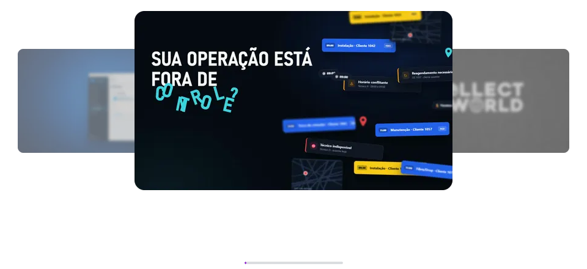
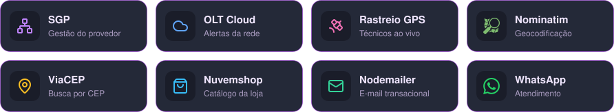

**Desenvolvedor full-stack e designer gráfico** · Estudante de Ciência da Computação na Faculdade Anchieta · Fundador da **KollectBR**

Crio sistemas internos, sites e interfaces que unem **programação, design e marketing**: do layout no Figma ao deploy com Node.js, PM2 e Nginx. Gosto de transformar ideias em soluções que realmente ajudam empresas e equipes no dia a dia.

- 🔭 Atualmente desenvolvendo soluções digitais para empresas: sistemas internos, sites e automações
- 🎨 Designer freelancer para marcas, restaurantes, times de e-sports e streamers da Twitch
- 🧊 Tocando a KollectBR: colecionáveis, figures, Funkos e impressão 3D
- 🌎 Português (nativo) · Inglês (avançado) · Espanhol (básico)

<h3 align="left"> Contato</h3>

 

<h3 align="left"> Projetos em Destaque</h3>

<table>
  <tr>
    <td>
      <h4> Chat Interno Acessanet</h4>
      

        Sistema interno completo de comunicação, atendimento e suporte técnico de redes: conversas e grupos com envio de imagens, arquivos e áudios, comunicados e alertas em tempo real, agenda técnica, controle de plantão, páginas de procedimentos e treinamentos, cursos internos, área de vendas, permissões administrativas e tema claro/escuro.
      

      
<strong>Stack:</strong> React 19 · Vite · Tailwind · Node.js · Express 5 · Socket.IO · MySQL · JWT · bcrypt · Helmet · PM2/systemd

      
<a href="https://github.com/Olukasao/Intranet---Corporate-Workspace">Ver repositório</a>

    </td>
  </tr>
  <tr>
    <td>
      <h4> Site Projecta Empreendimentos</h4>
      

        Portal imobiliário com cadastro único de imóveis, publicação no site, gestão de leads, usuários, corretores e proprietários, auditoria e permissões por cargo, do layout até o deploy.
      

      
<strong>Stack:</strong> React · Vite · Tailwind · Node.js · Express · Prisma · MariaDB/MySQL · Zod · JWT · Sharp · Nginx

      
<a href="https://github.com/Olukasao/Projecta2">Ver repositório</a>

    </td>
  </tr>
  <tr>
    <td>
      <h4> Site AcessaNet + Central do Assinante</h4>
      

        Site institucional do provedor com área do cliente (faturas, chamados com triagem automática, promessa de pagamento, assinatura de documentos, status da rede) e painel administrativo. Backend integrado ao SGP e à OLT Cloud para detectar incidentes de rede. O site novo traz a Terra em 3D com three.js.
      

      
<strong>Stack:</strong> React · Vite · three.js · GSAP · TypeScript · Fastify · Zod · MySQL/SQLite · Vitest

      
<a href="https://site-acessa-net-v2-rebranding.vercel.app">Ver site</a> · <a href="https://github.com/Olukasao/SiteAcessaNetV2">Ver repositório</a>

    </td>
  </tr>
  <tr>
    <td>
      <h4> Agenda de Técnicos · Acessanet Telecom</h4>
      

        Painel de NOC para a equipe de campo: agenda de ordens de serviço, turnos e ausências, GPS dos técnicos em tempo real, mapa de chamados com geocodificação automática, sugestão e comparação de rotas e indicadores de chamados críticos.
      

      
<strong>Stack:</strong> Node.js · Express · Socket.IO · MariaDB · Leaflet · migrations SQL · Playwright

      
<a href="https://github.com/Olukasao/Agenda-tecnicos">Ver repositório</a>

    </td>
  </tr>
  <tr>
    <td>
      <h4> Site KollectBR</h4>
      

        Site estático da loja, gerado por um build próprio em Node.js sem framework: catálogo sincronizado com a loja virtual (Nuvemshop), imagens otimizadas em AVIF/WebP, filme da marca no topo e cartas holográficas.
      

      
<strong>Stack:</strong> JavaScript · Node.js · Sharp · HTML/CSS · Vercel

      
<a href="https://kollect-site.vercel.app">Ver site</a> · <a href="https://github.com/Olukasao/Kollect-Site">Ver repositório</a>

    </td>
  </tr>
  <tr>
    <td>
      <h4> Assistente Jurídico</h4>
      

        Aplicativo desktop para Windows e macOS que organiza rotinas jurídicas e prompts de IA. Gera .exe e .app, com build automático para Mac no GitHub Actions.
      

      
<strong>Stack:</strong> Python · PyInstaller · GitHub Actions

      
<a href="https://github.com/Olukasao/SistemaJuridico">Ver repositório</a>

    </td>
  </tr>
  <tr>
    <td>
      <h4> Rebranding e Artes Visuais Acessanet</h4>
      

        Rebranding visual do site e da comunicação digital da marca: banners, campanhas promocionais, peças comerciais e institucionais e padronização visual para redes sociais.
      

      
<strong>Ferramentas:</strong> Photoshop · Figma · branding · social media

    </td>
  </tr>
  <tr>
    <td>
      <h4> KollectBR</h4>
      

        Loja de colecionáveis, figures, Funkos, peças 3D e produtos geek/anime. Cuido de branding, vendas, conteúdo, importação, gestão de produtos e ativações presenciais em eventos automotivos, gastronômicos, feiras e exposições.
      

    </td>
  </tr>
</table>

 

<h3 align="left"> Portfólio de Design</h3>

  

 

<h3 align="left"> Motion Design</h3>

  

 

<h3 align="left"> Experiência</h3>

- **Programação, Marketing & Design · Dias Gestão** *(atual)*: desenvolvimento de sistemas e sites, marketing digital e design para os clientes Acessanet e Projecta Empreendimentos
- **Designer freelancer**: identidade visual, campanhas e social media para Hookah Like, Dreams Car, times de e-sports, streamers da Twitch e restaurantes
- **T.I (PJ) · MK Academy**: suporte técnico a várias filiais, manutenção, configuração de sistemas e criação de soluções internas
- **Marketing · Ortobom**: criação de conteúdo, peças visuais e campanhas de divulgação
- **Projetos acadêmicos e pessoais**: rebranding do site da Unianchieta (HTML, CSS, JavaScript e JSON Server), CRUD em Python com MongoDB feito em equipe e bot de Discord em Node.js com discord.js

 

<h3 align="left"> Stack</h3>

**Linguagens**

**Front-end**

**Back-end & Banco de Dados**

**Testes**

**Infra, Deploy & Versionamento**

**Design & 3D**

  

**Integrações**

  

 

<h3 align="left"> Segurança</h3>

Práticas que aplico nos sistemas que desenvolvo:

- **Autenticação:** senhas com hash (bcrypt), JWT com segredo forte obrigatório em produção, política de senha, troca obrigatória no primeiro acesso, OTP por e-mail e limite de tentativas de login
- **Autorização:** permissões por perfil e cargo e checagem de posse dos dados em cada rota
- **Proteção da API:** Helmet, CORS restrito, rate limit, validação de entrada com Zod e sanitização contra XSS e injeção
- **Rastreabilidade:** logs de auditoria das ações administrativas e controle de sessões
- **Segredos e dados:** credenciais só em `.env` (fora do Git), `.env.example` documentado e dados reais, uploads e backups fora do repositório
- **Deploy seguro:** HTTPS, deploy atômico (sem misturar arquivos de versões diferentes) e backup do banco antes de cada publicação

**Áreas que conecto no dia a dia:** front-end, back-end, sistemas internos, suporte técnico, redes, automação, design gráfico, UI/UX, branding, marketing digital, e-commerce e importação.

 

<h3 align="left"> Atividade</h3>

  
  

  

GitWorld: commits viram prédios, repositórios viram cidades, issues viram monstros.

 

  
Créditos

* Badges por <a href="https://shields.io/">shields.io</a>; ícones da Stack gerados por <code>scripts/build_skill_rows.py</code> a partir de <a href="https://skillicons.dev">skillicons.dev</a>, <a href="https://simpleicons.org">Simple Icons</a>, <a href="https://devicon.dev">Devicon</a> e <a href="https://lucide.dev">Lucide</a>.
* Estatísticas geradas por <code>scripts/build_stats.py</code> (GitHub GraphQL API); contador de visitas por <a href="https://komarev.com/github-profile-views-counter/">komarev</a>.
* Emojis animados por <a href="https://github.com/Tarikul-Islam-Anik/Animated-Fluent-Emojis">Animated Fluent Emojis</a>.
* Cidade por <a href="https://github.com/Dasmat13/git-world-action">GitWorld Engine</a>.
* Ícones de ferramentas por <a href="https://devicon.dev">Devicon</a> e <a href="https://simpleicons.org">Simple Icons</a>; onda do rodapé por <a href="https://github.com/kyechan99/capsule-render">capsule-render</a>.

  
Feito com 💜 por <a href="https://github.com/Olukasao">Olukasao</a>.

  

