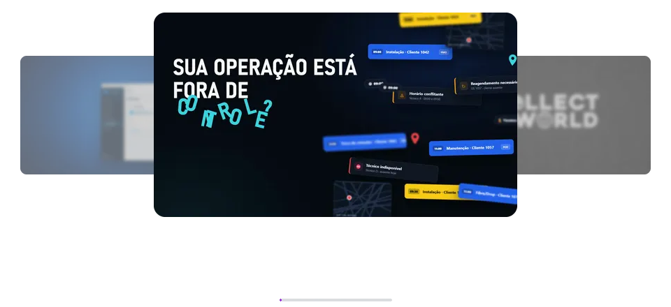
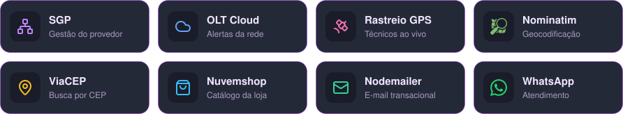

  

https://github.com/user-attachments/assets/d0d2338f-44f4-4e61-8473-62421720b99a

  

 

**Desenvolvedor full-stack e designer gráfico** · Estudante de Ciência da Computação na Faculdade Anchieta · Fundador da **KollectBR**

Crio sistemas internos, sites, **apps mobile (Android e iPhone)** e interfaces que unem **programação, design e marketing**: do layout no Figma ao deploy com Node.js, PM2 e Nginx, e até a publicação na Google Play e na App Store. Gosto de transformar ideias em soluções que realmente ajudam empresas e equipes no dia a dia.

- 🔭 Atualmente desenvolvendo soluções digitais para empresas: sistemas internos, sites, apps mobile e automações
- 📱 Experiência em gerenciar, desenvolver e lançar apps para Android e iOS: do planejamento à publicação nas lojas e às atualizações
- 🖥️ Também construo **aplicativos desktop (Electron)**, com **telefonia SIP em C++**, atualização automática assinada e integrações com os sistemas da operação
- 🛰️ Atuo com **infraestrutura de redes**: coleta e histórico de rotas **BGP via BMP**, com Docker, PostgreSQL e Grafana
- 🎨 Designer freelancer para marcas, restaurantes, times de e-sports e streamers da Twitch
- 🧊 Tocando a KollectBR: colecionáveis, figures, Funkos e impressão 3D
- 🌎 Português (nativo) · Inglês (avançado) · Espanhol (básico)

<h3 align="left"> Contato</h3>

 

<h3 align="left"> Projetos em Destaque</h3>

<table>
  <tr>
    <td>
      <h4> Workscape · Plataforma desktop para provedor de internet</h4>
      

        Aplicativo desktop que reúne o dia a dia da operação: chat interno, agenda de técnicos, painel de NOC, ferramentas de rede, <strong>softphone SIP próprio</strong>, assistente de IA (com modelo local opcional) e módulo de cursos com provas e certificados. Atualização automática com <strong>assinatura verificada</strong>, comunicação entre processos validada com Zod, janelas destacáveis e telefone isolado em processo separado.
      

      
<strong>Stack:</strong> Electron · React 19 · TypeScript · Vite · Zustand · Tailwind · Socket.IO · Zod · Vitest · Playwright · electron-builder

      
<a href="https://github.com/Olukasao/Workscape_Platform">Ver repositório</a>

    </td>
  </tr>
  <tr>
    <td>
      <h4> Workscape Phone Engine · Motor de softphone SIP</h4>
      

        Motor de telefonia em <strong>C++17</strong> sobre PJSIP/PJSUA2, rodando em processo separado e controlado por um protocolo JSON por linhas. Registro, chamadas de entrada e saída, mudo, espera, transferência, DTMF, Não perturbe e níveis de áudio em tempo real. O build de Windows roda no GitHub Actions, com o PJSIP baixado por versão fixa e o hash SHA-256 conferido. Registro e chamada validados contra uma central SIP real.
      

      
<strong>Stack:</strong> C++17 · PJSIP/PJSUA2 · SIP · RTP · MSVC · GitHub Actions

      
<a href="https://github.com/Olukasao/Workscape_Phone_Engine">Ver repositório</a>

    </td>
  </tr>
  <tr>
    <td>
      <h4> Support Console · Painel de atendimento em tempo real</h4>
      

        Console web para atendentes responderem clientes que conversam pelo chat de um app. Fila com SLA visual e prioridade automática, categorias, <strong>macros</strong> acionadas por atalho, <strong>automações</strong> QUANDO → SE → ENTÃO, monitoramento da operação, auditoria e controle por cargo. Somente frontend, com sessão decidida pelo servidor e modo de demonstração para desenvolvimento.
      

      
<strong>Stack:</strong> React 19 · TypeScript · Vite · React Router · Socket.IO · Oxlint

      
<a href="https://github.com/Olukasao/support-console-App_de_Atendimento_ao_Cliente">Ver repositório</a>

    </td>
  </tr>
  <tr>
    <td>
      <h4> BGP Timeline · Monitoramento de rotas com OpenBMP</h4>
      

        Implantação isolada e endurecida do OpenBMP para acompanhar rotas BGP via protocolo BMP (RFC 7854). Segredos fora do Git, serviços internos presos em localhost, usuário somente leitura para o Grafana, permissões por container sem <code>chmod 777</code> e scripts que nunca apagam volumes. Estado e histórico das atualizações ficam no PostgreSQL, com dashboard provisionado.
      

      
<strong>Stack:</strong> OpenBMP · BGP/BMP · Docker Compose · Kafka · PostgreSQL (TimescaleDB) · Grafana

      
<a href="https://github.com/Olukasao/bgp-timeline">Ver repositório</a>

    </td>
  </tr>
  <tr>
    <td>
      <h4> Motion Player · Player de vídeos para TV</h4>
      

        Player independente que toca uma playlist de vídeos em loop na TV, pela rede local. A lista se monta sozinha ao copiar arquivos para uma pasta, os controles somem quando não usados e o servidor suporta requisições parciais de vídeo. Node.js puro, sem dependências e sem build.
      

      
<strong>Stack:</strong> Node.js · HTML/CSS/JavaScript · PM2

      
<a href="https://github.com/Olukasao/Motion_Player">Ver repositório</a>

    </td>
  </tr>
  <tr>
    <td>
      <h4> App AcessaNet · Central do Assinante</h4>
      

        App mobile da Central do Assinante (Android e iPhone): faturas, boleto e PIX, chamados, status da rede, notificações push, deep links, aviso de offline e atualização obrigatória de versão. Tokens da sessão guardados no Keystore do aparelho, CSP, links externos só por domínios permitidos, build de release assinado com R8 e adequação à LGPD. Cuidei do ciclo inteiro: ícone e splash, ficha da loja, formulário de segurança dos dados, notas de versão e publicação.
      

      
<strong>Stack:</strong> React · Vite · Capacitor · Android (Gradle, AAB, R8) · iOS · Push Notifications · Secure Storage

      
<a href="https://github.com/Olukasao/AcessaNet-App-Android">Ver repositório</a>

    </td>
  </tr>
  <tr>
    <td>
      <h4> Chat Interno Acessanet</h4>
      

        Sistema interno completo de comunicação, atendimento e suporte técnico de redes: conversas e grupos com envio de imagens, arquivos e áudios, comunicados e alertas em tempo real, agenda técnica, controle de plantão, páginas de procedimentos e treinamentos, cursos internos, área de vendas, permissões administrativas e tema claro/escuro.
      

      
<strong>Stack:</strong> React 19 · Vite · Tailwind · Node.js · Express 5 · Socket.IO · MySQL · JWT · bcrypt · Helmet · PM2/systemd

      
<a href="https://github.com/Olukasao/Corporate_Chat_Platform">Ver repositório</a>

    </td>
  </tr>
  <tr>
    <td>
      <h4> Site Projecta Empreendimentos</h4>
      

        Portal imobiliário com <strong>rebranding completo feito do zero</strong>: cadastro único de imóveis, publicação no site, gestão de leads, usuários, corretores e proprietários, auditoria e permissões por cargo, do layout até o deploy.
      

      
<strong>Stack:</strong> React · Vite · Tailwind · Node.js · Express · Prisma · MariaDB/MySQL · Zod · JWT · Sharp · Nginx

      
<a href="https://github.com/Olukasao/Site_Projecta_V2">Ver repositório</a>

    </td>
  </tr>
  <tr>
    <td>
      <h4> Site AcessaNet + Central do Assinante</h4>
      

        Site institucional do provedor com área do cliente (faturas, chamados com triagem automática, promessa de pagamento, assinatura de documentos, status da rede) e painel administrativo. Backend integrado ao SGP e à OLT Cloud para detectar incidentes de rede. O site novo traz a Terra em 3D com three.js.
      

      
<strong>Stack:</strong> React · Vite · three.js · GSAP · TypeScript · Fastify · Zod · MySQL/SQLite · Vitest

      
<a href="https://site-acessa-net-v2-rebranding.vercel.app">Ver site</a> · <a href="https://github.com/Olukasao/Site_Acessa_Net">Ver repositório</a>

    </td>
  </tr>
  <tr>
    <td>
      <h4> Agenda de Técnicos · Acessanet Telecom</h4>
      

        Painel de NOC para a equipe de campo: agenda de ordens de serviço, turnos e ausências, GPS dos técnicos em tempo real, mapa de chamados com geocodificação automática, sugestão e comparação de rotas e indicadores de chamados críticos.
      

      
<strong>Stack:</strong> Node.js · Express · Socket.IO · MariaDB · Leaflet · migrations SQL · Playwright

      
<a href="https://github.com/Olukasao/Agenda-de-tecnicos">Ver repositório</a>

    </td>
  </tr>
  <tr>
    <td>
      <h4> Site KollectBR</h4>
      

        Site estático da loja, gerado por um build próprio em Node.js sem framework: catálogo sincronizado com a loja virtual (Nuvemshop), imagens otimizadas em AVIF/WebP, filme da marca no topo e cartas holográficas.
      

      
<strong>Stack:</strong> JavaScript · Node.js · Sharp · HTML/CSS · Vercel

      
<a href="https://kollect-site.vercel.app">Ver site</a> · <a href="https://github.com/Olukasao/Kollect-Site">Ver repositório</a>

    </td>
  </tr>
  <tr>
    <td>
      <h4> KollectBR</h4>
      

        Loja de colecionáveis, figures, Funkos, peças 3D e produtos geek/anime. Cuido de branding, vendas, conteúdo, importação, gestão de produtos e ativações presenciais em eventos automotivos, gastronômicos, feiras e exposições.
      

    </td>
  </tr>
</table>

 

<h3 align="left"> Portfólio de Design</h3>

  

<h4 align="left">O que já criei</h4>

<table>
  <tr>
    <td width="33%" valign="top">
      <strong>Marca & impressos</strong> 
      Rebranding de logo · cartão de visita · panfleto · cardápio de restaurante · caixa e embalagem personalizada · adesivagem de frota
    </td>
    <td width="33%" valign="top">
      <strong>Varejo & campanhas</strong> 
      Design para loja de carros · marcas de narguilé · social media e layouts para Instagram · artes de campanha e datas comemorativas
    </td>
    <td width="33%" valign="top">
      <strong>Streaming & games</strong> 
      Artes para canais da Twitch e do YouTube · times de e-sports · servidores do Discord · overlays e aberturas de live
    </td>
  </tr>
  <tr>
    <td width="33%" valign="top">
      <strong>Motion</strong> 
      Motion para eventos famosos · filmes de marca · vídeos de produto e de sistemas · GIFs animados
    </td>
    <td width="33%" valign="top">
      <strong>Interfaces</strong> 
      Sites, portais e sistemas internos: do layout no Figma ao código em produção
    </td>
    <td width="33%" valign="top">
      <strong>Fotomanipulação</strong> 
      Composições de produto e cenário, tratamento de imagem e direção de arte para colecionáveis
    </td>
  </tr>
</table>

 

<h3 align="left"> Motion Design</h3>

  

 

<h3 align="left"> Experiência</h3>

- **Programação, Marketing & Design · Dias Gestão** *(atual)*: desenvolvimento de sistemas e sites, marketing digital e design para os clientes Acessanet e Projecta Empreendimentos
- **Desenvolvimento e lançamento de apps mobile (Android e iOS)**: gestão do projeto do começo ao fim (escopo, versões e prazos), desenvolvimento, testes em aparelhos reais, assinatura dos builds, publicação e atualizações na Google Play Console e na App Store Connect, ficha da loja, políticas de privacidade e segurança dos dados
- **Aplicativo desktop (Electron) e telefonia SIP**: arquitetura, interface e backend de uma plataforma interna para provedor de internet, com softphone próprio em C++ (PJSIP), atualização automática assinada, build e distribuição automatizados no GitHub Actions
- **Painéis de atendimento em tempo real**: console com Socket.IO, fila com SLA, macros e automações, controle por cargo e testes automatizados
- **Infraestrutura de redes**: implantação e endurecimento de uma pilha de monitoramento BGP (OpenBMP, Kafka, PostgreSQL, Grafana) com Docker, mínimo privilégio e firewall
- **Designer freelancer**: identidade visual, campanhas e social media para Hookah Like, Dreams Car, times de e-sports, streamers da Twitch e restaurantes
- **T.I (PJ) · MK Academy**: suporte técnico a várias filiais, manutenção, configuração de sistemas e criação de soluções internas
- **Marketing · Ortobom**: criação de conteúdo, peças visuais e campanhas de divulgação
- **Projetos acadêmicos e pessoais**: rebranding do site da Unianchieta (HTML, CSS, JavaScript e JSON Server), CRUD em Python com MongoDB feito em equipe e bot de Discord em Node.js com discord.js

 

<h3 align="left"> Stack</h3>

**Linguagens**

**Front-end**

**Mobile (Android & iOS)**

- **Linguagens:** Kotlin, Java, Swift, JavaScript e TypeScript
- **Desenvolvimento:** apps híbridos com React + Capacitor e integração com recursos nativos (push, armazenamento seguro, deep links, status bar, teclado, splash, rede)
- **Gestão e lançamento:** planejamento de versões, builds assinados (APK/AAB e IPA), Google Play Console, App Store Connect, TestFlight, ficha da loja, política de privacidade e LGPD

**Back-end & Banco de Dados**

**Desktop & Telefonia**

**Redes & Observabilidade**

**Testes**

**Infra, Deploy & Versionamento**

**Design & 3D**

  

**Integrações**

  

 

<h3 align="left"> Segurança</h3>

Práticas que aplico nos sistemas que desenvolvo:

- **Autenticação:** senhas com hash (bcrypt), JWT com segredo forte obrigatório em produção, política de senha, troca obrigatória no primeiro acesso, OTP por e-mail e limite de tentativas de login
- **Autorização:** permissões por perfil e cargo e checagem de posse dos dados em cada rota
- **Proteção da API:** Helmet, CORS restrito, rate limit, validação de entrada com Zod e sanitização contra XSS e injeção
- **Rastreabilidade:** logs de auditoria das ações administrativas e controle de sessões
- **Atualizações assinadas:** o app desktop só instala versões com assinatura válida, com chave pública embutida e política de versão mínima
- **Isolamento e IPC validado:** processos separados (por exemplo, o telefone), canais entre processos validados com Zod e senha de ramal só em memória
- **Infraestrutura:** serviços internos presos em localhost, usuário de banco somente leitura, permissões por container sem `chmod 777` e porta pública restrita por firewall
- **Segredos e dados:** credenciais só em `.env` (fora do Git), `.env.example` documentado e dados reais, uploads e backups fora do repositório
- **Deploy seguro:** HTTPS, deploy atômico (sem misturar arquivos de versões diferentes) e backup do banco antes de cada publicação

**Áreas que conecto no dia a dia:** front-end, back-end, apps mobile, sistemas internos, suporte técnico, redes, automação, design gráfico, UI/UX, branding, marketing digital, e-commerce e importação.

 

<h3 align="left"> Atividade</h3>

  
  

  

GitWorld: commits viram prédios, repositórios viram cidades, issues viram monstros.

 

  
Créditos

* Badges por <a href="https://shields.io/">shields.io</a>; ícones da Stack gerados por <code>scripts/build_skill_rows.py</code> a partir de <a href="https://skillicons.dev">skillicons.dev</a>, <a href="https://simpleicons.org">Simple Icons</a>, <a href="https://devicon.dev">Devicon</a> e <a href="https://lucide.dev">Lucide</a>.
* Estatísticas geradas por <code>scripts/build_stats.py</code> (GitHub GraphQL API); contador de visitas por <a href="https://komarev.com/github-profile-views-counter/">komarev</a>.
* Emojis animados por <a href="https://github.com/Tarikul-Islam-Anik/Animated-Fluent-Emojis">Animated Fluent Emojis</a>.
* Cidade por <a href="https://github.com/Dasmat13/git-world-action">GitWorld Engine</a>.
* Ícones de ferramentas por <a href="https://devicon.dev">Devicon</a> e <a href="https://simpleicons.org">Simple Icons</a>; onda do rodapé por <a href="https://github.com/kyechan99/capsule-render">capsule-render</a>.

  
Feito com 💜 por <a href="https://github.com/Olukasao">Olukasao</a>.

  

